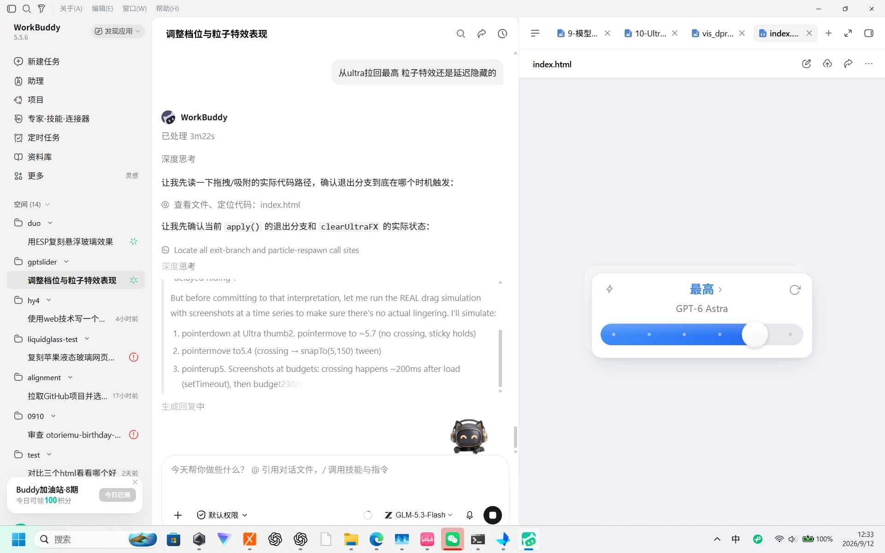
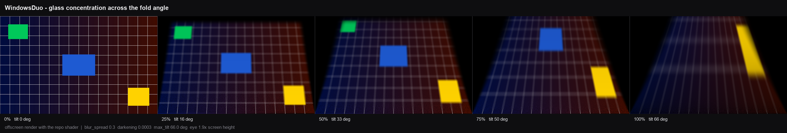

# WindowsDuo

**中文 | [English](README.en.md)**

> **本仓库是一次复刻**，基于 [KaedeharaKazuha1029/WindowsDuo](https://github.com/KaedeharaKazuha1029/WindowsDuo)（MIT）。
>
> 复刻内容：主控由 ESP32 换成 **STM32F103C8T6（Blue Pill）**，并新增 **ESP8266 串口 WiFi 透传**——
> 原版只能拖 USB 串口线，现在可以做到转轴处零线缆、100Hz 无线回传。
> 逆投影着色器与互补滤波算法沿用原项目，改动清单见下方「与 ESP32 原版的差异」。

在 Windows / macOS 笔记本上复刻 **iPhone Duo 折叠屏的「悬浮玻璃」效果**：屏幕开合时，桌面内容像隔着一层绕铰链旋转的玻璃——开合角度越大，内容越模糊、越暗，视线出界处渐变为纯黑。



## 效果原理

这不是简单的全屏高斯模糊，而是**空间化的逆投影**：

- 桌面内容固定在世界空间的平面上不动，屏幕则是一块绕底边铰链向观察者旋转的"玻璃"
- 每个像素从眼睛发射线穿过玻璃像素，交到界面平面上得到采样点
- 间隙越大 → 采样半径越大（模糊越强）、衰减越多（越暗）；靠近铰链处始终清晰
- 采样使用 Vogel 螺旋盘 + mip LOD 分级 + 边缘覆盖率平滑，单 pass GLSL 着色器完成

理论模型参考自多个开源复刻（DuoLikeAnimation / iphone-duo / MacDuo / FrostFold），按笔记本场景（铰链 = 屏幕底边）重新实现。

## 不同浓度的观感



同一套着色器在 0% / 25% / 50% / 75% / 100% 浓度下的离屏渲染（合成测试图，不含任何桌面内容）。
浓度由开合角线性映射；越接近合盖，内容越像隔着一块斜玻璃塌陷、变暗，视线出界处转为纯黑。
想用自己的参数重出这张图：`win/looksheet.py`。

## 四个版本

| 版本 | 平台 | 开合角度来源 | 硬件要求 |
|---|---|---|---|
| **Windows + ESP32** | Windows | 外接 ESP32 + MPU6050 陀螺仪 | 一块 ESP32 开发板 + MPU6050 |
| **Windows + STM32** | Windows | 外接 STM32F103C8T6 + MPU6050（本项目移植） | Blue Pill + GY-521 + CH340（+ ST-Link 烧录） |
| **macOS Port** | macOS | MacBook 内置盖角传感器 (HID) | 无外接硬件（2016+ 机型） |
| **纯手动** | Windows / macOS | 键盘调节 | 无 |

> **本机复刻记录**：实际硬件为 STM32F103C8T6 + GY-521 + ST-Link V2，无线走 NodeMCU（ESP-12E）。
> 固件已移植到 `stm32/bluepill_mpu6050/`（PlatformIO + Arduino core），串口协议与原版完全一致
> （`{"a":..,"b":..}` @115200），再加 `stm32/esp8266_bridge/` 做 UART→TCP 透传，实测无线 100Hz。
> 为适配 Intel Iris Xe 驱动，渲染层改了两处：GLSL 用 `330 core`（`gl_VertexID` 画全屏四边形，
> 不经顶点属性）、窗口用 `QOpenGLWindow` 而非 `QOpenGLWidget`。踩坑细节见
> [AGENTS.md](AGENTS.md) 与 [stm32/bluepill_mpu6050/README.md](stm32/bluepill_mpu6050/README.md)。

## 目录结构

```
esp32/                    ESP32 固件 + 串口调试工具 (原版方案)
  mpu6050_angle/          ESP-IDF 工程: 零漂校准 + 互补滤波, 100Hz 输出角度 JSON
  debug_view.py|.bat      串口实时角度查看器
stm32/
  bluepill_mpu6050/       STM32F103C8T6 移植版固件 + build.bat / flash.bat
  esp8266_bridge/         ★ 无线: NodeMCU/ESP-01 的 UART→TCP 透传桥 (含 find_ip.py)
win/                      Windows 端主程序
  glass_overlay.py        PyQt6 + OpenGL 全屏悬浮层 (串口 / TCP 两路输入)
  config.json             运行参数
  offscreen_test.py       着色器离屏验证
  lookdev.py              用真实桌面离屏试参数 (出 win/looks/*.png)
  looksheet.py            用合成测试图生成 docs/effect-stages.png 效果对比图
  calibrate.py            两点标定: 合盖/全开角度写回 config.json
  fix_ch340.bat           CH340 串口被蓝牙占号(代码 31)时的修复脚本
  run_overlay.bat         串口驱动启动   /  run_wifi.bat  无线启动
  run_manual.bat          纯键盘启动     /  run_calibrate.bat  标定
mac/                      macOS 版 (详见 mac/README.md)
  glass_overlay_mac.py    主程序: 内置盖角传感器 + OpenGL Core
  lid_sensor.py|.py       HID 传感器读取 / 意图识别状态机
```

## 快速开始

### Windows + ESP32

1. 接线（掌控板 / 通用 ESP32 + MPU6050，I2C）：`P19=SCL→GPIO22`，`P20=SDA→GPIO23`，MPU6050 接该 I2C 总线
2. 烧录固件（需 ESP-IDF v5.x）：
   ```
   python esp32/mpu6050_angle/run_build.py -p COM3 flash
   ```
3. 运行 Windows 端：
   - `win/run_overlay.bat` — ESP 角度驱动（键盘 `r` 切换手动/自动）
   - `win/run_manual.bat` — 纯键盘手动
4. 键盘操作（先点一下控制台窗口获得焦点）：`↑/↓` 浓度 ±3%，`←` 清零，`→` 拉满，`r` 切换控制方，`Esc` 退出

### macOS

```bash
python3 -m venv .venv-mac && source .venv-mac/bin/activate
pip install PyQt6 PyOpenGL numpy Pillow pyobjc-framework-Cocoa pyobjc-framework-Quartz
python mac/glass_overlay_mac.py          # 自动模式
python mac/glass_overlay_mac.py --manual # 手动模式
```

需要"屏幕录制"权限，详见 [mac/README.md](mac/README.md)。

## 主要参数 (`config.json`)

| 参数 | 含义 | 本仓库取值 |
|---|---|---|
| `angle_closed` / `angle_open` | 角度映射：合盖 / 全开对应的角度 | 88 / 30（装好屏幕后跑 `run_calibrate.bat` 覆盖） |
| `blur_spread` | 模糊扩散系数（越小越通透） | 0.30 |
| `darkening` | 随间隙变暗的强度 | 0.0003 |
| `eye_dist_h` | 视点距离（屏幕高度的倍数） | 1.9 |
| `max_tilt_deg` | 最大倾角 | 66 |
| `refresh_hz` | 桌面截图刷新率 | 3 |
| `port` / `tcp` | 串口 / 无线地址（`"auto"` = 自动扫描网段） | COM3 / auto |
| `lock_at_close` | 合盖到底自动锁屏 | false |

原版取值是 `blur 0.42 / darkening 0.001 / tilt 88 / eye 2.0`；在深色主题桌面上满浓度会接近全黑，
所以本仓库整体调柔和了一档（用 `win/lookdev.py` 出图对比过）。

## 已知坑

详见 [AGENTS.md](AGENTS.md)：GL 窗口必须用 `QOpenGLWindow`（Intel 驱动下 `QOpenGLWidget` 屏幕全黑）、
GLSL 必须 `330 core`、截图反馈污染与自排除、bat 文件禁中文、中文路径导致工具链链接失败等。

## License

[MIT](LICENSE)

## Credits

- elijah-semyonov/DuoLikeAnimation — 逆投影模型与 Vogel 盘模糊公式
- chuspeeism/iphone-duo — mip LOD 分级采样与边缘覆盖率平滑
- DhananjayBhosale/MacDuo — 笔记本场景（铰链=屏幕底边，盖角度驱动）
- askmaddyy/FrostFold — 磨砂玻璃观感参数
- macOS 端传感器协议参考 [Mac-Duo by sumimakito](https://github.com/sumimakito/MacDuo) (Apache-2.0)
